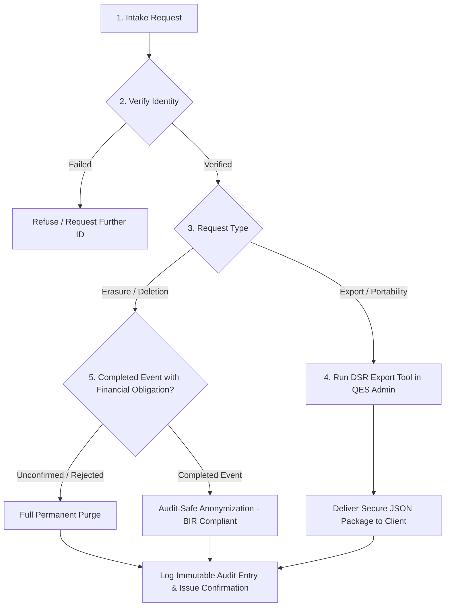

# Data-Subject Request (DSR) Standard Operating Procedure
**Organization:** Tyoy Creation Event Styling  
**System:** Quick Event Styling (QES) Platform  
**Compliance Standard:** Republic Act No. 10173 (Philippine Data Privacy Act of 2012), Rule VIII of the Implementing Rules and Regulations (IRR)  
**Effective Date:** October 2026  
**Document Owner:** Data Protection Officer (DPO) & Customer Privacy Operations  

---

## 1. Purpose & Scope

This Standard Operating Procedure (SOP) defines the operational workflow for receiving, validating, and fulfilling requests submitted by individuals ("Data Subjects") exercising their statutory rights under Chapter VIII, Section 34 of the Philippine Data Privacy Act of 2012 (RA 10173).

Specifically, this procedure governs:
1. **Right of Access & Right to Data Portability (Section 34(c) & Section 36):** Fulfilling requests for copies of personal data in an electronic, structured, machine-readable format (**Export**).
2. **Right to Erasure or Blocking (Section 34(e)):** Suspending, removing, or permanently destroying personal data from the QES platform filing system (**Delete / Anonymize**).
3. **Right to Rectification (Section 34(d)):** Correcting inaccurate, outdated, or misleading contact information.

---

## 2. Statutory Timelines & Responsibilities

- **Maximum Fulfillment Window:** Requests must be processed and resolved within **fifteen (15) to thirty (30) calendar days** from date of receipt and identity verification, pursuant to National Privacy Commission (NPC) guidance.
- **Fees:** All standard DSR requests are processed **free of charge**.
- **Designated Roles:**
  - **Data Protection Officer (DPO):** Reviews and authorizes all DSR actions. Contact: `privacy@tyoycreation.com`.
  - **Lead Administrator:** Executes technical export or erasure tools in the QES Admin Portal (`a_clients.php` / `data_privacy_helper.php`).

---

## 3. Step-by-Step Procedure

### Step 1: Intake & Logging
- **Intake Channels:** Data subjects may file requests via email to `privacy@tyoycreation.com` or via shop phone `+63 912 345 6789`.
- **Mandatory Information Required:**
  1. Full Name
  2. Registered Email Address and/or Mobile Contact Number
  3. Booking Reference Number (if applicable, e.g., `EV-2026-1234`)
  4. Specific nature of request: **Export (Access/Portability)** or **Erasure (Deletion)**.

### Step 2: Identity Verification
To prevent unauthorized disclosure of personal data to impersonators:
- Verify that the inbound email matches the registered email address on file.
- If request is submitted via phone or by a third party, request a valid Philippine government-issued photo ID (e.g. UMID, PhilID, Driver's License, Passport) or dispatch an OTP confirmation challenge.

---

## 4. Technical Execution in QES Platform

### 4.1. Data Export Procedure (Right to Data Portability - JSON Package)
1. Log into the QES Admin Portal (`loginadmin.php`) as an authorized Administrator.
2. Navigate to **Client Information** (`a_clients.php`).
3. Locate the client record using the search bar (searches across encrypted name, email, or phone).
4. Click the **Export DSR** button (`<i class="fa-solid fa-file-export"></i>`).
5. The QES engine calls `DataPrivacyHelper::exportDataSubjectArchive($conn, $identifier)`:
   - Queries and decrypts all records matching the client.
   - Packages client identity, contact data, booking logs, itemized pricing, event dates, and notification history into a standardized `.json` package.
   - File format: `DSR_Export_[ClientName]_[Timestamp].json`.
6. Dispatch the generated file securely to the verified email address of the data subject with an encrypted password or via secure direct download.

### 4.2. Data Erasure Procedure (Right to Erasure / Deletion)
1. On **Client Information** (`a_clients.php`), click the **Delete / Erasure** button.
2. The system prompts the administrator to select between:
   - **Mode A: Permanent Purge:** Completely drops the booking records, item selections, and notification history. Recommended for unconfirmed inquiries, cancelled events, or test data.
   - **Mode B: Audit-Safe Anonymization (Recommended for Confirmed/Completed Events):**
     - Scrubs client name: Replaced with `[Anonymized - DSR Erasure Request]`.
     - Completely clears client phone, email, and venue street address.
     - Deletes associated personal notification records.
     - Preserves the anonymous booking reference number and financial estimate total to satisfy the Philippine Bureau of Internal Revenue (BIR) 5-year accounting and tax audit regulations.
3. Once executed, an immutable system audit entry is written to `notifications` logging:
   `DSR Erasure Request executed by [AdminUsername] on [Timestamp] under RA 10173`.
4. Issue a formal confirmation letter to the client informing them that their personal data has been erased.

---

## 5. Client Communication Templates

### Template A: Data Export Completion Notice
> **Subject:** Response to Data-Subject Access Request – Tyoy Creation Event Styling  
> **Dear [Client Name],**  
>  
> In accordance with Republic Act No. 10173 (Data Privacy Act of 2012) and your recent Data Subject Access Request, please find attached your personal data export file in a structured, machine-readable JSON format.  
>  
> This package contains all personal information, booking specifications, and communication logs currently maintained within our systems.  
>  
> If you have questions regarding this export or require assistance with any other data privacy rights, please contact our Data Protection Officer at `privacy@tyoycreation.com`.  
>  
> Sincerely,  
> **Data Privacy Team**  
> Tyoy Creation Event Styling  

### Template B: Right to Erasure Completion Notice
> **Subject:** Confirmation of Personal Data Erasure – Tyoy Creation Event Styling  
> **Dear [Client Name],**  
>  
> This letter confirms that your request for the erasure of your personal data held by Tyoy Creation Event Styling has been successfully fulfilled.  
>  
> All personally identifiable information, including your full name, contact numbers, email address, and home/venue location records, has been permanently removed or anonymized from our active databases in accordance with Section 34(e) of the Data Privacy Act of 2012.  
>  
> If you have any further inquiries, please contact `privacy@tyoycreation.com`.  
>  
> Sincerely,  
> **Data Privacy Team**  
> Tyoy Creation Event Styling  
