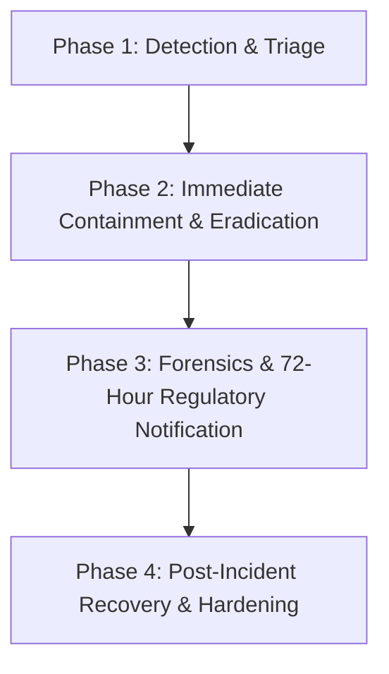

# Security Incident & Data Breach Response Plan
**Organization:** Tyoy Creation Event Styling  
**System:** Quick Event Styling (QES) Platform  
**Compliance Standard:** Republic Act No. 10173 (Philippine Data Privacy Act of 2012), National Privacy Commission (NPC) Circular 16-03 (Personal Data Breach Management)  
**Effective Date:** October 2026  
**Document Owner:** Data Protection Officer (DPO) & Incident Commander  

---

## 1. Objectives & Executive Mandate

This Security Incident & Data Breach Response Plan defines the mandatory operational framework to prepare for, detect, contain, investigate, and recover from any security incident or personal data breach affecting the Tyoy Creation QES infrastructure.

In compliance with **National Privacy Commission (NPC) Circular 16-03**, this plan ensures:
1. Immediate containment of security threats to prevent data exfiltration.
2. Protection of client personal identifiable information (PII).
3. Compliance with the statutory **72-Hour mandatory notification requirement** to the National Privacy Commission.
4. Timely and transparent communication to affected clients.
5. Continuous remediation and post-incident root-cause analysis (CAPA).

---

## 2. Data Breach Response Team (DBRT)

The Data Breach Response Team is activated immediately upon confirmation of a Security Incident.

| Role | Title / Responsibility | Contact Channel |
| :--- | :--- | :--- |
| **Incident Commander & DPO** | Overall incident coordination, regulatory liaising with the NPC, legal compliance | `privacy@tyoycreation.com` / `+63 912 345 6789` |
| **Technical & Forensics Lead** | Server isolation, log analysis, vulnerability eradication, database key rotation | `tech@tyoycreation.com` |
| **Communications Lead** | Public relations, official client notifications, media management | `contact@tyoycreation.com` |
| **Legal Counsel** | Regulatory filings, compliance assessment under RA 10173 | Retained Legal Counsel |

---

## 3. Incident Severity & Classification Matrix

| Severity Level | Description & Trigger Examples | Target Containment SLA | Regulatory Notification |
| :--- | :--- | :--- | :--- |
| **P1 - Critical Data Breach** | Confirmed unauthorized acquisition, theft, or exposure of client PII (names, contact numbers, emails, addresses); database exfiltration; ransomware infection. | **Within 1 Hour** | **MANDATORY NPC Notification within 72 Hours** + Affected Client Notices |
| **P2 - High Incident** | Compromise of an administrative account; unauthorized elevation of privileges; failure of field encryption or key exposure; active SQL injection attempts with data access. | **Within 2 Hours** | Internal notification; NPC notification if PII exposure is suspected |
| **P3 - Medium Incident** | Distributed Denial of Service (DDoS) impacting portal availability; repeated brute-force attacks against `loginadmin.php` triggering IP lockouts; isolated malware on admin endpoint. | **Within 4 Hours** | Internal logging; containment via rate limiters & Cloudflare Turnstile |
| **P4 - Low Incident** | Minor anomalous scan; spam submissions caught by captcha; automated bot probing blocked by `.htaccess`. | **Within 24 Hours** | Routine operational security review |

---

## 4. Four-Phase Incident Response Lifecycle



### Phase 1: Detection, Triage & Assessment
1. **Identification Sources:**
   - Automated alerts (rate limiting spikes, failed login surges, HMAC decryption errors).
   - Server error logs (`apache/logs/error.log`, `php_error.log`).
   - Reports from staff, clients, or third-party security researchers.
2. **Initial Assessment Checklist:**
   - What data was accessed or compromised? Is it encrypted at rest (`ENC::v1::`)?
   - How many individuals are potentially affected?
   - Is the breach ongoing or isolated?
   - Is there a real risk of serious harm, fraud, or identity theft to affected clients?

### Phase 2: Immediate Containment & Eradication Runbook
1. **Step 1 - Revoke Active Administrative Sessions:**
   - In `a_settings.php`, use **"Block All Other Devices"** or execute:
     ```sql
     UPDATE user_sessions SET is_blocked = 1;
     ```
2. **Step 2 - Rotate Secrets & Encryption Keys:**
   - If server compromise is suspected, immediately update `.env.php`:
     - Rotate `DB_PASS` and database connection credentials.
     - Generate and deploy fresh `QES_ENCRYPTION_KEY` and `QES_HMAC_KEY`.
     - Rotate Turnstile secret keys and admin passwords.
3. **Step 3 - Quarantine Malicious Traffic / IP Ban:**
   - Append malicious source IPs to `.htaccess`:
     ```apache
     Require not ip 198.51.100.25
     ```
4. **Step 4 - Isolate Affected Endpoints:**
   - Temporarily place the public booking endpoint into maintenance mode if vulnerability is active.

### Phase 3: Investigation, Forensics & Regulatory Reporting

#### 3.1. Mandatory 72-Hour NPC Notification Rule
Under Section 38 of the DPA IRR and NPC Circular 16-03:
- If personal data breach involves sensitive personal information or information that may be used to enable identity fraud, AND there is reason to believe that the data was acquired by an unauthorized person:
  - **The National Privacy Commission MUST be formally notified within seventy-two (72) hours** of obtaining knowledge of the breach.
  - Notification must be submitted via email to: `complaints@privacy.gov.ph` / `dpo@privacy.gov.ph`.

#### 3.2. Mandatory Client Notification
- Affected data subjects must be notified without undue delay within seventy-two (72) hours of determination.
- Notification must clearly describe:
  1. Nature of the breach.
  2. Personal data likely affected.
  3. Measures taken by Tyoy Creation to address the breach.
  4. Steps data subjects can take to protect themselves.
  5. Contact info of the Data Protection Officer.

### Phase 4: Post-Incident Review & System Hardening (CAPA)
1. Reconstruct breach timeline and root cause within five (5) business days.
2. Perform patch deployment and regression testing using the automated PHPUnit test suite (`phpunit`).
3. Archive all forensic evidence, server access logs, and communications for a minimum of five (5) years.
4. Prepare formal post-mortem report and submit to executive leadership.

---

## 5. Regulatory Notification Templates

### Template 1: Official NPC Breach Notification (Within 72 Hours)
```text
TO: National Privacy Commission (NPC)
EMAIL: complaints@privacy.gov.ph / dpo@privacy.gov.ph
SUBJECT: Formal Personal Data Breach Notification - Tyoy Creation Event Styling

1. Personal Information Controller:
   - Organization: Tyoy Creation Event Styling
   - System Affected: Quick Event Styling (QES)
   - Contact Person: Data Protection Officer (privacy@tyoycreation.com / +63 912 345 6789)

2. Description of the Incident:
   - Date and time breach was discovered: [YYYY-MM-DD HH:MM T]
   - Estimated date and time breach occurred: [YYYY-MM-DD HH:MM T]
   - Manner in which breach occurred: [Unauthorized access / Server exploit / Credential compromise]

3. Nature of Personal Data Involved:
   - Specific data fields affected: [e.g., Client Names, Contact Numbers, Email Addresses, Event Venues]
   - Security measures applied: All data fields are protected at rest via AES-256 authenticated encryption.
   - Number of data subjects potentially affected: [Approximate number]

4. Containment & Remedial Actions Taken:
   - All compromised sessions revoked immediately.
   - Master database credentials and API tokens rotated.
   - Firewall and IP filtering updated.

5. Assistance and Point of Contact:
   - Data Protection Officer: privacy@tyoycreation.com
```

### Template 2: Notice to Affected Clients (Data Subjects)
```text
Subject: Important Security Notice Regarding Your Event Booking Information

Dear Valued Client,

We are writing to inform you of a recent security incident that may have affected information associated with your event booking inquiry at Tyoy Creation.

What Happened:
On [Date], our security monitoring detected an unauthorized access attempt to our administrative systems. We immediately isolated the affected service, terminated all active sessions, and initiated forensic investigations.

What Information Was Involved:
The affected database record included your name, contact phone number, email address, and event venue specifications. Please note that no credit card, debit card, or financial banking details are stored on our servers. All sensitive client records are further protected with AES-256 field encryption.

What We Are Doing:
We have reinforced our firewalls, rotated all cryptographic keys, engaged with our Data Protection Officer, and formally notified the National Privacy Commission in accordance with Republic Act No. 10173.

What You Can Do:
We recommend remaining vigilant against unsolicited communications, suspicious text messages, or phishing emails asking for payments or passwords. Remember that Tyoy Creation coordinators will never ask for your passwords or OTP verification codes over the phone.

For Any Questions:
You may contact our Data Protection Officer directly at privacy@tyoycreation.com or via mobile at +63 912 345 6789.

Sincerely,
Data Protection Officer & Management Team
Tyoy Creation Event Styling
```
